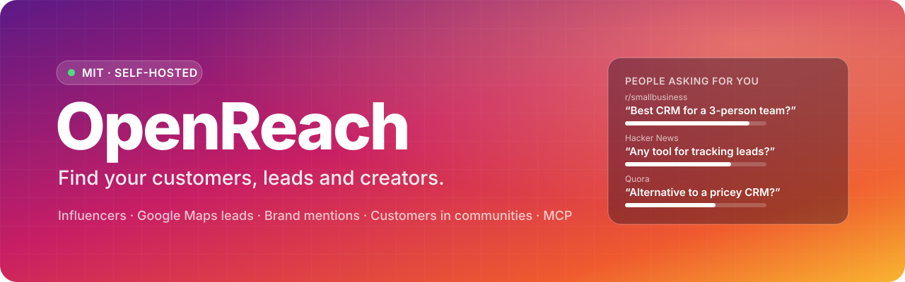

<p align="center">
  <a href="https://openreach.gg"></a>
</p>

<p align="center">
  <a href="LICENSE"></a>
  <a href="#-self-host-with-docker"></a>
  <a href="https://openreach.gg/docs/mcp"></a>
</p>

<p align="center">
  
  
  
  
  
  
</p>

<h3 align="center">
  <a href="https://openreach.gg">Website</a>
  &nbsp;·&nbsp;
  <a href="https://openreach.gg/docs">Docs</a>
  &nbsp;·&nbsp;
  <a href="https://openreach.gg/docs/self-hosting">Self-hosting</a>
  &nbsp;·&nbsp;
  <a href="https://openreach.gg/docs/mcp">Connect an agent</a>
  &nbsp;·&nbsp;
  <a href="https://openreach.gg/tools">Free tools</a>
</h3>

<br>

**OpenReach** is an open-source suite for finding your first customers and the people who can reach them. Find influencers on YouTube, TikTok and Instagram, build lead lists of local businesses from Google Maps, hear every time your product is mentioned across Reddit, Hacker News, GitHub, Stack Overflow and review sites, and find people asking for exactly what you sell. Run it on your own machine or server, read every line, and hand it to your AI agent.

No monthly plan: the software is free, and data is paid per lookup, under a monthly limit you set. Finding creators for a niche costs about $0.02, a page of 20 businesses $0.07, a brand-mention check across a dozen communities about $0.10.

⭐ **If OpenReach is useful to you, a star helps other people find it.**

> [!NOTE]
> OpenReach is early and in active development. [Issues](https://github.com/duckduckdeploy/openreach/issues) and ideas are very welcome.

## ✨ Why OpenReach

- 🔓 **Open source, all of it.** The app, the API and the agent server are MIT licensed.
- 🏠 **Your server, your data.** One Docker command runs everything. Your creators, leads and conversations stay in your own database.
- 💸 **No surprise bills.** Every call is listed with its cost, and a monthly limit stops all spending once it is reached.
- 🤖 **Agents on a leash.** 38 MCP tools cover the whole workspace. Every paid tool takes `dry_run` and `max_cost_usd`.
- 🙋 **Finds, never spams.** OpenReach finds and organises. It never posts, comments, DMs or emails anyone for you.
- 🧭 **Plays by the rules.** Community data comes from official APIs (Hacker News, GitHub, Stack Exchange, Reddit) and search results. OpenReach never scrapes around a site's blocks.

## 🧰 What's inside

<table>
  <tr>
    <th width="26%" align="left">Area</th>
    <th align="left">What you get</th>
  </tr>
  <tr>
    <td width="26%">🎥 Influencer finder</td>
    <td>Creators on YouTube, TikTok and Instagram for any niche, ranked by how often they come up for it. Analyse the ones worth a look: followers, average views, engagement rate, posts per week, last post, emails and links in their bio. Instagram lookalikes. Free filters on everything</td>
  </tr>
  <tr>
    <td width="26%">🗺️ Lead finder</td>
    <td>Businesses on Google Maps for any search and place, with phone, website, rating, reviews and hours. Filter rules with all/any groups: no website, under 20 reviews, rated under 4, a word in the name… Lead searches run many queries across many places, or a grid over a whole city, in the background. Emails from the business's homepage or an email directory</td>
  </tr>
  <tr>
    <td width="26%">📣 Brand mentions</td>
    <td>Monitors that check 69 communities on a schedule (Reddit, Quora, Hacker News, GitHub, Stack Overflow, X, LinkedIn, Product Hunt, Indie Hackers, G2, Capterra, app stores and more) and list what's new, with sentiment and a replied/ignored status</td>
  </tr>
  <tr>
    <td width="26%">🎯 Customer finder</td>
    <td>People asking for what you sell: “best … for”, “looking for”, “alternative to …” threads, scored 0–100 for buying intent, with an optional AI check that keeps only real requests</td>
  </tr>
  <tr>
    <td width="26%">#️⃣ Subreddit finder</td>
    <td>The subreddits and communities where your topic comes up most, ranked by threads, replies and how recent they are</td>
  </tr>
  <tr>
    <td width="26%">📋 Lists and pipeline</td>
    <td>Saved creators and leads with a status (to contact, contacted, replied, won), notes, tags, bulk actions and CSV export</td>
  </tr>
</table>

## 🐳 Self-host with Docker

You need [Docker](https://docs.docker.com/get-docker/). On Windows or macOS that's Docker Desktop with at least 4 GB of memory.

```bash
git clone https://github.com/duckduckdeploy/openreach.git openreach
cd openreach
cp .env.example .env
# In .env, set AUTH_SECRET (32+ random characters)
# and ENCRYPTION_KEY (openssl rand -base64 32)
docker compose up -d --build
```

| Service | Address |
|---|---|
| Dashboard | http://localhost:3300 |
| Site and docs | http://localhost:3301 |
| API and MCP | http://localhost:4300 (`/api/*`, `/mcp`) |

One image runs everything: Postgres, the API with its MCP server and background worker, the dashboard and the site. Database migrations run when the API starts.

**On a cloud server with your own domain**, point your domain, `app.` and `api.` at the server, set `OPENREACH_DOMAIN`, `APP_URL`, `WEB_URL`, `PUBLIC_API_URL` and `POSTGRES_PASSWORD` in `.env`, then run `docker compose --profile https up -d --build` for automatic HTTPS.

**Optional keys** in `.env` raise the free community APIs' limits: `GITHUB_TOKEN`, `STACKEXCHANGE_KEY`, and `REDDIT_CLIENT_ID` / `REDDIT_CLIENT_SECRET` (a Reddit app; without it, Reddit is searched through Google results).

## 🤖 Connect your AI agent

The MCP server gives agents the whole workspace as 38 tools: find and analyse creators, search Maps, run lead searches, monitor mentions, find conversations, and manage the saved lists.

**ChatGPT and Claude (web and desktop):** add a custom connector with the URL `{API_URL}/mcp` and OAuth sign-in. No key needed.

**Claude Code:** install the plugin, which bundles the connection and five skills:

```bash
/plugin install openreach --marketplace duckduckdeploy/openreach
```

Set `OPENREACH_API_KEY` (create one in Settings) and, when self-hosting, `OPENREACH_MCP_URL`.

**Any other MCP client:** add `{API_URL}/mcp` with the header `Authorization: Bearer <key>`.

### 🧩 Skills

| Skill | What it does |
|---|---|
| [`find-influencers`](plugins/openreach/skills/find-influencers/SKILL.md) | Creators who reach your audience, analysed, shortlisted and saved |
| [`find-leads`](plugins/openreach/skills/find-leads/SKILL.md) | Local businesses that fit your pitch, filtered, with emails |
| [`brand-monitor`](plugins/openreach/skills/brand-monitor/SKILL.md) | Where your product is talked about, and the mentions worth a reply |
| [`find-customers`](plugins/openreach/skills/find-customers/SKILL.md) | People asking for what you sell, ranked by intent, with reply drafts |
| [`community-plan`](plugins/openreach/skills/community-plan/SKILL.md) | The communities worth being active in, and a plan to start |

Every skill prices paid steps with `dry_run` first and passes the limit you agree as `max_cost_usd`. None of them posts or sends anything: replies and messages are drafts for you to send.

## 🔎 Data

Social, Maps, search and email data come from [YepAPI](https://yepapi.com?ref=openreach). You add your own key when you set up your account, and each lookup is billed to it. Hacker News, GitHub and Stack Exchange are searched through their free official APIs, and Reddit through its official API when you register an app.

## 🛠️ Development

Requirements: Node 26+, pnpm 10, Postgres 15+ (or `docker compose up -d postgres`).

```bash
pnpm install
pnpm db:migrate
pnpm dev                 # API :4300, dashboard :3300, site :3301, with live reload
pnpm typecheck
pnpm test
```

The tests need no database, network or API keys. `apps/api/test` runs the real API against an in-memory Postgres (PGlite) with the real migrations and a stand-in for the data provider and the community APIs (`apps/api/src/testing/fake-yepapi.ts`). For local work without a data key, run the stand-in with `pnpm --filter @openreach/api fake-yepapi` and set `YEPAPI_BASE_URL` and `COMMUNITY_API_BASE_URL` to `http://localhost:4399`.

```
apps/api          Fastify API, MCP server, background worker (pg-boss)
apps/app          Dashboard (Next.js)
apps/web          Public site and docs (Next.js)
packages/yepapi   Typed data client with price estimates
packages/shared   Source registry, filter rules, creator and lead models
```

## 🔐 Security

- Stored data keys are encrypted at rest with AES-256-GCM (`ENCRYPTION_KEY`) and never returned by the API.
- API keys are stored as SHA-256 hashes and shown once.
- OAuth for MCP clients: dynamic client registration, PKCE (S256), exact redirect URIs, single-use codes, one-hour access tokens, rotating refresh tokens.
- Paid lookups are not retried after a server error or a lost connection, since they may already have been billed.
- In Docker, the app, site and API listen only on the machine itself. The optional Caddy service is the only thing facing the internet.

## 🤝 Contributing

Clear [issues](https://github.com/duckduckdeploy/openreach/issues) are the most useful contribution: what you did, what you expected and what happened. For code, run `pnpm typecheck` and `pnpm test` before opening a pull request.

## 📄 Licence

[MIT](LICENSE). Use it, change it, host it.
